# ESIC KMS (EKMS) — Architecture & Design Specification

> **Project Target**: Modernizing the ESIC Knowledge Management System from Vanilla HTML/CSS/JS to **Next.js (App Router) + TypeScript + Tailwind CSS + Firebase (Modular SDK) + Netlify**.

---

## 1. System Mission & Core Roles

The **EKMS (ESIC Knowledge Management System)** is an enterprise knowledge base, facility locator, assessment platform, and appointment booking system tailored for ESIC (Employee State Insurance Corporation) operations and insurance agents.

```mermaid
graph TD
    A[EKMS Platform] --> B[Agent Portal]
    A --> C[Admin Portal]
    
    B --> B1[Global Search & Guidance]
    B --> B2[File Repository & Downloads]
    B --> B3[Doubt Submission & Discussion]
    B --> B4[Health Facility Directory & Map]
    B --> B5[IP / IW Seat Booking & Rescheduling]
    B --> B6[Quizzes & Onboarding Modules]
    B --> B7[Personal Activity & Scores]

    C --> C1[System Overview & KPIs]
    C --> C2[Seat Availability & Calendar Rules]
    C --> C3[Detailed Booking Analytics & Reschedule Logs]
    C --> C4[Facility Directory Management ESIC & NHM]
    C --> C5[Doubt Resolution & Leaderboard]
    C --> C6[Announcements & Broadcasts]
    C --> C7[Q&A, Files, Teams & Onboarding Management]
    C --> C8[Agent Activity Reports & Excel Export]
```



### Role Breakdown

| Role | Access Level | Primary Responsibilities |
| :--- | :--- | :--- |
| **Agent** (User) | Public & Authenticated Agent | Search knowledge base, download forms/circulars, ask doubts, take quizzes, view onboarding guides, book and reschedule IP/IW visits, view personal performance. |
| **Admin** | Restricted (`role: 'Admin'`) | Manage availability calendars, resolve doubts, create announcements, manage facilities (add/edit/bulk import), update files/Q&A, monitor agent daily activity. |
| **Master Admin** | Unrestricted (`role: 'Master Admin'`) | Full administrative controls + user role management, system settings, database synchronization, bulk deletion privileges. |

---

## 2. Directory & Route Hierarchy (Next.js App Router)

All pages are cleanly separated into **Agent Routes** and **Admin Routes** with clear, semantic names (completely replacing legacy flat `.html` file naming).

```
app/
├── (agent)/                        # Agent Portal Layout & Routes
│   ├── page.tsx                    # / (Home: Guidance Search, Recent Updates)
│   ├── layout.tsx                  # Agent layout (Navbar + Mini/Expanded Sidebar)
│   ├── files/                      # /files (Document & Circular Repository)
│   │   └── page.tsx
│   ├── doubts/                     # /doubts (Community Doubts & Discussions)
│   │   └── page.tsx
│   ├── facility/                   # /facility (Health Facilities Directory & Map)
│   │   └── page.tsx
│   ├── updates/                    # /updates (News & Announcements)
│   │   └── page.tsx
│   ├── booking/                    # /booking (Agent IP/IW Seat Booking)
│   │   └── page.tsx
│   ├── onboarding/                 # /onboarding (Training & Guides)
│   │   └── page.tsx
│   ├── quiz/                       # /quiz (Interactive Assessments)
│   │   └── page.tsx
│   ├── team/                       # /team (Team Directory)
│   │   └── page.tsx
│   ├── profile/                    # /profile (Agent Profile, Badges & History)
│   │   └── page.tsx
│   └── reports/                    # /reports (Personal Agent Reports)
│       └── page.tsx
│
├── admin/                          # Admin Portal Layout & Protected Routes
│   ├── layout.tsx                  # Admin layout (Protected with Role Guard)
│   ├── page.tsx                    # Redirects to /admin/overview
│   ├── overview/                   # /admin/overview (KPI Dashboard & Analytics)
│   │   └── page.tsx
│   ├── bookings/                   # /admin/bookings (Availability Calendar & Logs)
│   │   └── page.tsx
│   ├── facilities/                 # /admin/facilities (ESIC & NHM Directory CRUD)
│   │   └── page.tsx
│   ├── doubts/                     # /admin/doubts (Resolve Doubts & Leaderboard)
│   │   └── page.tsx
│   ├── announcements/              # /admin/announcements (Broadcast Notices)
│   │   └── page.tsx
│   ├── qa/                         # /admin/qa (Manage Q&A Database)
│   │   └── page.tsx
│   ├── files/                      # /admin/files (Manage Documents & Categories)
│   │   └── page.tsx
│   ├── updates/                    # /admin/updates (Manage News & Circulars)
│   │   └── page.tsx
│   ├── quiz/                       # /admin/quiz (Create & Manage Assessments)
│   │   └── page.tsx
│   ├── onboarding/                 # /admin/onboarding (Manage Training Modules)
│   │   └── page.tsx
│   ├── teams/                      # /admin/teams (Manage Agent Teams)
│   │   └── page.tsx
│   ├── missing-content/            # /admin/missing-content (Search Queries with no result)
│   │   └── page.tsx
│   ├── reports/
│   │   └── [email]/                # /admin/reports/[email] (Individual Agent Daily Log)
│   │       └── page.tsx
│   └── settings/                   # /admin/settings (System Configuration)
│       └── page.tsx
│
├── api/                            # Next.js API Routes (Optional server utilities)
├── components/                     # Reusable React / Tailwind Components
│   ├── common/                     # Modals, Badges, Loaders, Alerts, SearchBar
│   ├── layout/                     # EkmsNavbar, EkmsSidebar, EkmsMiniSidebar
│   ├── booking/                    # DualCalendar, MiniCalendar, RescheduleModal
│   ├── facility/                   # FacilityTable, BulkUploadModal, FacilityFilter
│   └── doubts/                     # DoubtCard, ResolveModal, LeaderboardTable
├── context/                        # AuthContext, NotificationContext, ThemeContext
├── lib/                            # firebase.ts, auth.ts, excelExport.ts, utils.ts
└── types/                          # TypeScript Interfaces for all Firestore Entities
```

---

## 3. Legacy Clean-Up & Naming Migration Guide

All YouTube-inspired (`yt-*`) class names and IDs are eliminated and converted to standard **Tailwind CSS utility classes** or semantic **`ekms-*` component wrappers**.

### Class & Component Naming Map

| Legacy HTML/CSS Class | New Next.js / Tailwind Equivalent | Purpose / Notes |
| :--- | :--- | :--- |
| `yt-navbar` | `<EkmsNavbar>` (`h-16 bg-white border-b border-slate-200 sticky top-0 z-50 flex items-center justify-between px-4 md:px-8`) | Main sticky top navigation bar |
| `yt-sidebar` | `<EkmsSidebar>` (`w-64 bg-white border-r border-slate-200 fixed left-0 top-16 bottom-0 z-40 transition-transform`) | Slide-out / persistent desktop sidebar |
| `yt-mini-sidebar` | `<EkmsMiniSidebar>` (`w-18 bg-white border-r border-slate-200 fixed left-0 top-16 bottom-0 flex flex-col items-center py-4`) | Compact icon-only sidebar for desktop |
| `yt-search-box` | `<EkmsSearchBar>` (`relative flex items-center w-full max-w-xl bg-slate-50 border border-slate-300 rounded-full focus-within:ring-2 focus-within:ring-blue-500`) | Global knowledge search bar |
| `yt-filled-btn` | `px-4 py-2 bg-blue-600 hover:bg-blue-700 text-white font-medium rounded-lg text-sm transition-colors shadow-sm inline-flex items-center gap-2` | Primary filled action button |
| `yt-text-btn` | `px-4 py-2 bg-transparent hover:bg-slate-100 text-slate-700 font-medium rounded-lg text-sm transition-colors inline-flex items-center gap-2` | Secondary/text action button |
| `yt-modal-content` | `<EkmsModal>` (`bg-white rounded-2xl shadow-2xl p-6 md:p-8 max-w-lg w-full border border-slate-100 transform transition-all`) | Centered modal container |
| `yt-input-group` | `<EkmsInput>` (`relative w-full mb-4`) with floating or top-aligned labels | Form input fields with focus states |
| `admin-metrics-grid` | `<EkmsMetricsGrid>` (`grid grid-cols-2 md:grid-cols-4 lg:grid-cols-6 gap-4 mb-8`) | KPI metric cards dashboard |
| `metric-card` | `<EkmsMetricCard>` (`bg-white border border-slate-200 rounded-xl p-5 flex items-center gap-4 shadow-sm hover:shadow-md transition-shadow`) | Single KPI stat box |
| `admin-table` | `<EkmsTable>` (`w-full border-collapse text-left text-sm text-slate-600`) inside a responsive `overflow-x-auto rounded-xl border border-slate-200` container | Standard responsive table |

---

## 4. Design Rules & Color System (Tailwind CSS)

### Color Palette

| Token | Hex Code | Tailwind Name | Usage |
| :--- | :--- | :--- | :--- |
| **Primary Brand** | `#1967d2` | `blue-600` / `ekms-primary` | Main actions, active navigation, key icons |
| **Brand Accent** | `#ff9800` | `amber-500` / `ekms-accent` | Bookings, warnings, highlights |
| **Success / Available** | `#137333` | `emerald-700` / `green-600` | Seats available, resolved doubts, visited status |
| **Danger / Unavailable** | `#c5221f` | `rose-600` / `red-600` | Seat full, delayed status, delete actions |
| **Background Light** | `#f8f9fa` | `slate-50` | Body background, dashboard backdrop |
| **Card / Surface** | `#ffffff` | `white` | Cards, modals, sidebars, tables |
| **Border Subtle** | `#e2e8f0` | `slate-200` | Dividers, card borders, table separators |
| **Text Main** | `#1e293b` | `slate-800` | Primary headings, table text, titles |
| **Text Muted** | `#64748b` | `slate-500` | Subtitles, timestamps, placeholders |

### Typography
* **Primary Font**: `Roboto`, `Inter`, or system UI (`font-sans`).
* **Scale**:
  * Page Titles: `text-2xl font-bold text-slate-800`
  * Section Titles: `text-lg font-semibold text-slate-800`
  * Body Text: `text-sm font-normal text-slate-600`
  * Metadata / Badges: `text-xs font-semibold tracking-wide uppercase`

### Layout & Responsiveness Guidelines
1. **Mobile-First Responsiveness**:
   * Mobile (< 768px): Header stacks title and action buttons; tables scroll horizontally with smooth touch scrolling (`-webkit-overflow-scrolling: touch`); metrics switch to a clean 2-column grid (`grid-cols-2`).
   * Desktop (≥ 1024px): Side-by-side dual calendars (`dual-calendar-grid`), multi-column metric grids, full table views.
2. **Accessible Interaction**:
   * All clickable items have hover and focus rings.
   * Feedback states (loading spinners, disabled buttons, copy-to-clipboard badges) are instant and clear.

---

## 5. Firebase Schema & Data Models

### 1. `users` Collection
Document ID: `user.email` (lowercase)
```typescript
interface UserProfile {
  email: string;
  displayName: string;
  role: 'Agent' | 'Admin' | 'Master Admin';
  photoURL?: string;
  createdAt: number;
  lastLoginAt: number;
  quizCompleted?: string[];           // e.g. ['Q1', 'Q2']
  quizScores?: Record<string, number>;// e.g. { 'Q1': 85, 'Q2': 90 }
  doubtsAsked?: number;
  doubtsResolved?: number;
}
```

### 2. `bookings` Collection
Document ID: `YYYY-MM-DD` (e.g. `2026-08-25`)
```typescript
interface BookingRecord {
  agentEmail: string;
  ipName: string;                     // Insured Person / Insured Woman Name
  phone: string;
  timestamp: number;                  // Original Booking Unix Timestamp
  visited: boolean;                   // Completed visit confirmation
  rescheduled?: boolean;              // Was this rescheduled
}

interface DayAvailability {
  seats: number;                      // Remaining available seats
  text?: string;                      // Admin message (e.g. "Public Holiday")
  bookedRecords?: BookingRecord[];
}
```

### 3. `rescheduleLogs` Collection
Document ID: Auto-generated Firestore ID
```typescript
interface RescheduleLog {
  id: string;
  ipName: string;
  seatOwner: string;                  // Original agent's email
  originalDate: string;               // YYYY-MM-DD
  newDate: string;                    // YYYY-MM-DD
  actionBy: string;                   // Admin or Agent email who executed the action
  timestamp: number;
}
```

### 4. `facilities` Collection
Document ID: Auto-generated Firestore ID
```typescript
interface Facility {
  id: string;
  name: string;
  category: 'ESIC' | 'NHM';
  type: 'ESIS Dispensary' | 'ESIC Hospital' | 'ESIC Tie-up Hospital' | 'Branch Office' | 'NHM PHC' | 'NHM CHC' | 'NHM SDH' | 'NHM DH' | string;
  address: string;
  block?: string;
  pincode?: string;
  district: string;
  state: string;
  lat?: number;
  lng?: number;
  mapLink?: string;
  createdAt: number;
  updatedAt: number;
}
```

### 5. `doubts` Collection
Document ID: Auto-generated Firestore ID
```typescript
interface Doubt {
  id: string;
  author: string;                     // Agent Name
  authorEmail: string;
  question: string;
  description?: string;
  status: 'pending' | 'waiting' | 'resolved';
  resolutionText?: string;
  resolvedBy?: string;                // Admin username
  resolvedByEmail?: string;
  createdAt: number;
  updatedAt?: number;
}
```

### 6. `announcements` Collection
Document ID: Auto-generated Firestore ID
```typescript
interface Announcement {
  id: string;
  message: string;                    // Supports markdown links [Text](URL)
  isVisible: boolean;
  postedBy: string;
  createdAt: number;
}
```

### 7. `daily_activity` Collection
Document ID: `${email.toLowerCase()}_${YYYY-MM-DD}`
```typescript
interface DailyActivity {
  email: string;
  name: string;
  date: string;                       // YYYY-MM-DD
  filesDownloaded: number;
  searches: string[];
  pageVisits: Record<string, number>; // { 'HOME': 320, 'FACILITIES': 180 } in seconds
}
```

---

## 6. Security, Authentication & Role Protection

1. **Client-Side Protected Layouts**:
   * Admin routes wrapped in `<AdminRouteGuard>` which verifies `userDoc.role === 'Admin' || userDoc.role === 'Master Admin'`.
   * Unauthenticated or non-admin visitors are safely redirected to `/` with a notification.
2. **Environment Variables**:
   * Firebase credentials stored safely in `.env.local` using `NEXT_PUBLIC_FIREBASE_*` variables.
3. **Optimistic Updates & Transactions**:
   * Booking reservation, rescheduling, and cancellation are handled using atomic **Firestore Transactions** (`runTransaction`) to completely prevent race conditions and overbooking.

---

## 7. Deployment Configuration (Netlify Free Tier)

* **Build Command**: `next build`
* **Publish Directory**: `.next`
* **Plugin**: `@netlify/plugin-nextjs`
* Configuration file: `netlify.toml`
```toml
[build]
  command = "npm run build"
  publish = ".next"

[[plugins]]
  package = "@netlify/plugin-nextjs"
```

---

## 8. Migration Step Plan

```mermaid
flowchart LR
    Step1[1. Upload Legacy Files] --> Step2[2. Setup Next.js Project & Dependencies]
    Step2 --> Step3[3. Firebase SDK & Auth Provider]
    Step3 --> Step4[4. Shared Components & Layouts]
    Step4 --> Step5[5. Agent Routes Porting]
    Step5 --> Step6[6. Admin Routes Porting]
    Step6 --> Step7[7. Excel & Advanced Features]
    Step7 --> Step8[8. Netlify Build & Verify]
```



1. **Step 1**: Review all user-provided HTML/JS/CSS source files.
2. **Step 2**: Initialize Next.js with TypeScript, Tailwind CSS, Lucide icons (or FontAwesome), and SheetJS (`xlsx`).
3. **Step 3**: Configure Firebase client instance & Auth Context.
4. **Step 4**: Build unified Navigation, Sidebar, Modals, and Cards (all cleaned of `yt-*`).
5. **Step 5**: Port Agent pages (`/`, `/files`, `/doubts`, `/facility`, `/booking`, `/quiz`, `/onboarding`, `/reports`).
6. **Step 6**: Port Admin pages (`/admin/overview`, `/admin/bookings`, `/admin/facilities`, `/admin/doubts`, `/admin/announcements`, `/admin/reports/[email]`, etc.).
7. **Step 7**: Test real-time Firestore synchronization and Excel report export.
8. **Step 8**: Add `netlify.toml` and verify static/SSR builds without errors.
